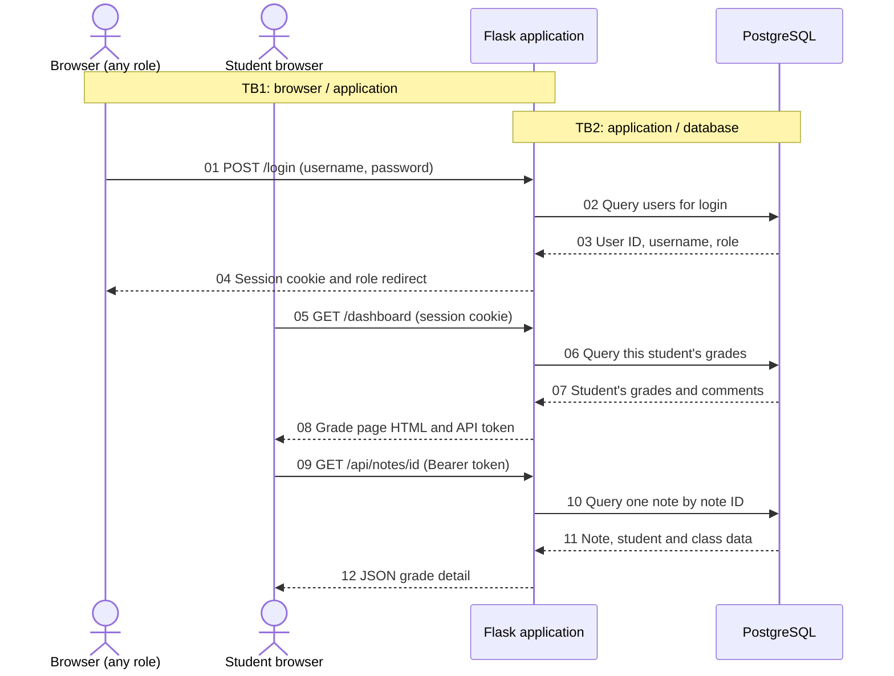
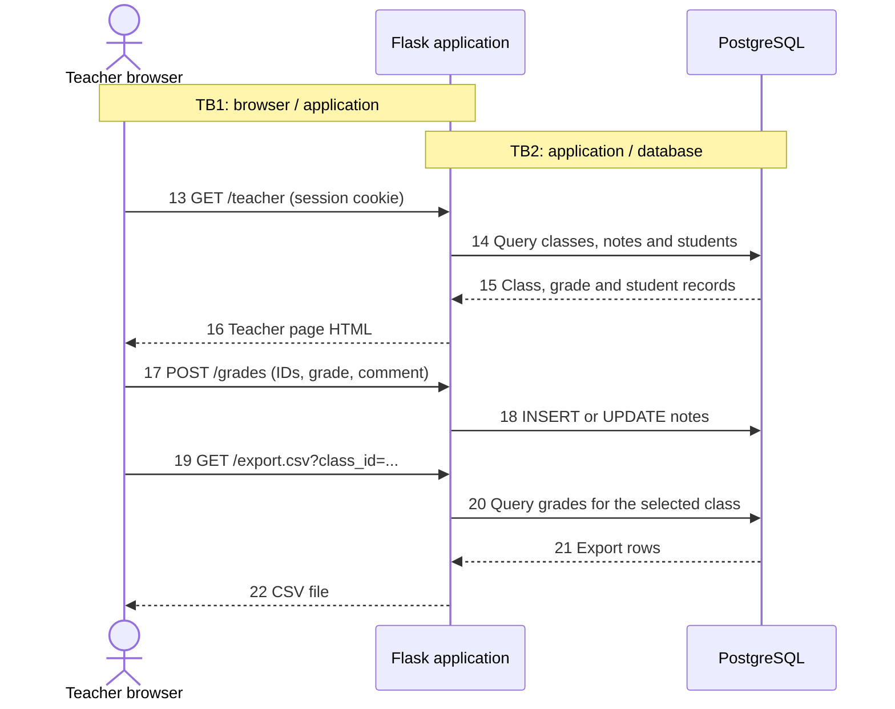
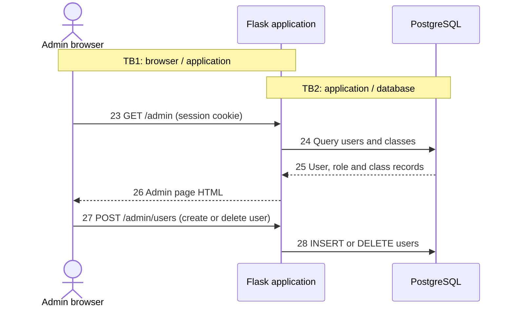

# Session 02 — NotesApp Numbered Data Flow Diagram

Model baseline: upstream NotesApp commit [`1c83e42`](https://github.com/KristenPire/NoteApp/commit/1c83e422429c4b784411701ffd797b5ab5f397dc) (Session 02).

- **TB1:** Browser ↔ Flask application
- **TB2:** Flask application ↔ PostgreSQL database

## A. Login and student grade views

[SVG diagram](diagrams/login-and-student.svg)

## B. Teacher grade management and export

[SVG diagram](diagrams/teacher.svg)

## C. Administrator user management

[SVG diagram](diagrams/admin.svg)

## Numbered flow list

| No. | Sender → Receiver | Boundary | Data crossing |
|---:|---|---|---|
| 01 | Browser → Flask | TB1 | `POST /login`: username and password. |
| 02 | Flask → PostgreSQL | TB2 | Login query against `users`. |
| 03 | PostgreSQL → Flask | TB2 | Matched user ID, username and role. |
| 04 | Flask → Browser | TB1 | Login result, session cookie and role redirect. |
| 05 | Student browser → Flask | TB1 | `GET /dashboard` with session cookie. |
| 06 | Flask → PostgreSQL | TB2 | Query `notes` and `classes` using the session user ID. |
| 07 | PostgreSQL → Flask | TB2 | The student's class names, grades, comments and note IDs. |
| 08 | Flask → Student browser | TB1 | Grade page HTML and an API token embedded in the page. |
| 09 | Student browser → Flask | TB1 | `GET /api/notes/<id>` with note ID and Bearer token. |
| 10 | Flask → PostgreSQL | TB2 | Query one `notes` record by note ID, joined with student and class data. |
| 11 | PostgreSQL → Flask | TB2 | One grade, comment, student and class record. |
| 12 | Flask → Student browser | TB1 | JSON response with grade details. |
| 13 | Teacher browser → Flask | TB1 | `GET /teacher` with session cookie. |
| 14 | Flask → PostgreSQL | TB2 | Queries for classes, notes and student usernames. |
| 15 | PostgreSQL → Flask | TB2 | Class, grade, comment and student records. |
| 16 | Flask → Teacher browser | TB1 | Teacher page HTML with classes, grades and grade form. |
| 17 | Teacher browser → Flask | TB1 | `POST /grades`: note ID, student ID, class ID, grade and comment. |
| 18 | Flask → PostgreSQL | TB2 | `INSERT` or `UPDATE` on `notes`. |
| 19 | Teacher browser → Flask | TB1 | `GET /export.csv` with optional `class_id`. |
| 20 | Flask → PostgreSQL | TB2 | Query grades for one class or all classes. |
| 21 | PostgreSQL → Flask | TB2 | Student, class, grade and comment rows for export. |
| 22 | Flask → Teacher browser | TB1 | CSV file containing those rows. |
| 23 | Admin browser → Flask | TB1 | `GET /admin` with session cookie. |
| 24 | Flask → PostgreSQL | TB2 | Queries for users and classes. |
| 25 | PostgreSQL → Flask | TB2 | User IDs, usernames, roles and class records. |
| 26 | Flask → Admin browser | TB1 | Admin page HTML with user and class lists. |
| 27 | Admin browser → Flask | TB1 | `POST /admin/users`: create-user fields or target user ID for deletion. |
| 28 | Flask → PostgreSQL | TB2 | `INSERT` or `DELETE` on `users`. |
